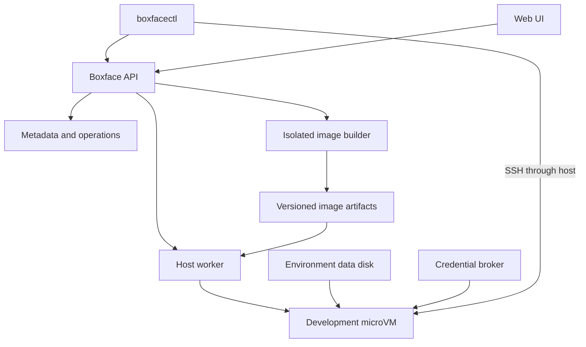

# Boxface Architecture

**Status:** Draft — proposed architecture, not an implemented system

---

## Overview

Boxface provides persistent development environments inside microVMs running on servers the user controls. A lightweight client, including a Linux tablet, can create an environment, connect to it, and use native coding-agent CLIs. The environment remains available when the client disconnects.

The initial user travels with a Xiaomi Pad 6 and owns ThinkCentre machines suitable for hosting development environments. The first goal is dependable daily remote development. Productisation follows evidence from that use and from other users; a managed cloud marketplace is not the initial scope. See the [Roadmap](./ROADMAP.md).

Supported workflows include interactive shells, Claude Code, Codex, OpenCode, Pi, ordinary builds, tests, Docker Compose services, and application previews. Agents are applications within an environment. Their exit does not determine the environment's lifetime.

Component design docs live in `docs/designs/`. Feature docs live in `docs/features/`.

## Scope & Boundaries

- This doc covers system boundaries, shared principles, cross-component flows, the metadata model, and trust boundaries.
- Interfaces, state machines, and failure handling for each component are in the [component design docs](#component-design-documents).
- User-visible behavior and acceptance scenarios are in [Remote Development Environments](./features/remote-development.md).

## Architecture Principles

### 1. The managed baseline is the microVM guest
- The configured OS is the **microVM guest**, not the host OS. The guest recipe never rebuilds or reconfigures the host distribution.
- Do not use NixOS. Build a conventional lightweight Linux guest from configuration with **mkosi**.
- Install declared developer tools through a build-time user-profile mechanism such as Home Manager, not as guest system packages. **chezmoi** owns personal configuration.
- mise is an optional declared user tool. It can install runtimes into the connected user's writable state after boot.

### 2. Immutable baseline, persistent user state
- Users cannot modify the managed OS or declared package profile after boot. A new baseline requires a configuration revision, build, and explicit deployment.
- Persistent repositories, user homes, dependencies, and agent state are separate from the managed baseline and survive image replacement.
- This is **not an executable allowlist**. Developers can run downloaded programs, compile software, and install user-scoped dependencies. A user can shadow a managed command through their own PATH; the guarantee concerns the baseline bytes and revision, not every executable a user chooses to run.

### 3. One API for every client
- CLI and web UI use the same recipes, environments, and server API.
- The client needs only network access and authentication. It needs no local image builder, Nix installation, KVM, or repository copy.

### 4. Runtime credentials only
- Credentials are supplied at runtime and never baked into images. The design supports a path to 1Password service accounts.

### 5. Native agents, no custom chat layer
- An environment supports multiple native agent CLIs without a mandatory custom chat interface. Boxface does not implement model reasoning, translate agent conversations, or assume a specific provider API.

### 6. Persist intent before acting
- Every mutation is a durable operation recorded before external actions. Resources are tagged with an environment or operation ID, and the worker reconciles actual resources with stored intent after restart.

## Decision Status

The principles above are agreed requirements. The following are proposed implementation choices, not validated integrations. The MVP starts with feasibility gates for the guest image, package profile, and container runtime ([Baseline Experiment](./plans/2026-10-baseline-experiment.md)).

| Decision | Initial proposal | Validation needed |
| --- | --- | --- |
| Guest distribution | Minimal Debian | Agent, browser, mise, native dependency compatibility |
| User package compiler | Nix + Home Manager, used in the builder only | Prebuilt closure and profile activation on a non-NixOS guest |
| Hypervisor | Firecracker as first candidate; Cloud Hypervisor as fallback | Rootless Docker, kernel, filesystem and boot behaviour |
| Docker execution | Rootless daemon using system-installed binaries | Representative Compose workloads and filesystem support |
| Metadata | SQLite on one host | Transactional operations and recovery behaviour |
| Persistent disk | One ext4 data image per environment initially | Mount layout, backup and crash recovery |
| Access | SSH through the host on a private network | Tablet connectivity and authentication flow |
| Implementation language | Not selected | Prefer a small native service/CLI stack; choose during implementation |

## System Topology

### Execution Locations

| Location | Responsibilities | Explicit exclusions |
| --- | --- | --- |
| Client device | CLI, browser UI, terminal, connection credentials | No local image builder, Nix installation, KVM, or repository copy required |
| Host server | API, worker, builds, images, disks, networking, secret resolution | Guest recipe does not rebuild or reconfigure the host distribution |
| MicroVM guest | Developer shell, agents, builds, tests, project services, user data | No management access to other environments or host Docker socket |

The host must be a supported Linux system with usable hardware virtualisation and KVM. Hardware capacity is not yet known. Do not promise concurrency until CPU, memory, and disk measurements exist.

### Components

All server components may run on one ThinkCentre. Logical separation does not imply separate network services or a microservice deployment.

**Proposed Components:**
- **[Boxface API](./designs/api.md)** - Authenticates clients, authorises access, validates configuration, stores immutable revisions, creates durable operations, and exposes environment state. It does not execute client-supplied privileged shell commands.
- **[Host Worker](./designs/host-worker.md)** - Performs a narrow set of privileged operations: creates disks, launches and stops VMs, configures network devices, and reconciles actual resources with stored intent. It owns cleanup and host-restart recovery.
- **[Image Builder](./designs/image-builder.md)** - Compiles recipes into mkosi inputs, builds the user package profile, assembles artifacts, and runs image smoke checks in an isolated build context.
- **Artifact store** - Stores kernel, root filesystem, optional initrd, user package closure, and manifest under immutable identifiers. For the MVP these may be bundled into one deployable revision while retaining separate logical ownership. Mutable recipe names resolve to revisions before an environment is created. Owned by the [Image Builder](./designs/image-builder.md#artifacts-and-manifest).
- **[Guest](./designs/guest.md)** - The read-only baseline, persistent mounts, guest identity, rootless Docker, and the guest integration service that reports readiness, coordinates lifecycle and credentials, and reports session status.
- **[Credential Broker](./designs/credential-broker.md)** - Resolves server-approved secret bindings and delivers only the selected values or capabilities to the correct environment and session.
- **[Access and Sessions](./designs/access-and-sessions.md)** - SSH gateway, named tmux sessions, and port forwarding.
- **[boxfacectl](./designs/cli.md)** and **[Web UI](./designs/web-ui.md)** - Clients of the same API.

## Shared Patterns

### Guest Layers

| Layer | Owner/tool | Content | Runtime mutability |
| --- | --- | --- | --- |
| OS | mkosi | Kernel, init, SSH, libraries, system services, Docker binaries/prerequisites | Read-only managed baseline |
| Declared user toolset | Build-time Home Manager/Nix profile | Agents, mise, baseline Node/Rust, utilities | Read-only profile and package store |
| Personal configuration | chezmoi | Shell, Git, editor and agent settings | Seeded/versioned; writable overrides by policy |
| Development state | Guest user | Repositories, mise runtimes, dependencies, sessions, caches | Writable, persistent |
| Runtime state | Guest services | Sockets, temporary files, runtime credential files | Writable, temporary |

Home Manager owns packages; chezmoi owns personal files. Do not allow both to manage the same files. Agent-written authentication and conversation state must not be overwritten by profile application. See [Guest](./designs/guest.md) and [Personal Configuration](./designs/personal-configuration.md).

### Revisions and Resolution

Recipes and profiles are stored as immutable revisions. Floating inputs such as a dotfiles branch or a requested tool version are resolved once and recorded; an environment records the exact image it runs. Existing environments never change silently: updates are explicit. See [Configuration](./designs/configuration.md).

### Durable Operations

Long-running mutations are asynchronous operations with idempotency keys and idempotent steps with durable completion records. Operation failure never erases an environment's actual resources. See [Operations](./designs/operations.md).

### Extension Points

Preserve narrow interfaces for hypervisor runtime, artifact storage, secret provider, and host placement. Implement one backend first. Future capabilities can include multiple workers, remote object storage, hosted compute, browser terminals, snapshots, and team access controls.

## Data / Control Flow

### Stage 1: Configure
**Input:** Recipe and profile YAML from the CLI or web UI
**Process:** The API validates the schema, rejects unknown fields and incompatible combinations, and stores the submitted source with a canonical representation as an immutable revision.
**Output:** Recipe and profile revisions

### Stage 2: Build
**Input:** An image-build operation for a recipe and profile revision
**Process:** The builder resolves pinned sources, computes a build key, reuses a ready artifact set when one matches, and otherwise builds the package profile and mkosi image in isolation, then boots a disposable validation guest.
**Output:** A ready, immutable artifact set with a resolved build manifest, or a failed build that never replaces a ready revision

### Stage 3: Create and Start
**Input:** A create or start operation naming an image and resource limits
**Process:** The worker creates or attaches the environment data disk, configures networking, launches the microVM, and waits for the guest integration service to report readiness. First initialisation generates per-environment identity and seeds personal configuration.
**Output:** A running environment whose observed state is recorded

### Stage 4: Connect and Work
**Input:** An authorised connection request
**Process:** The API returns SSH connection information; the client connects through the host gateway to a named tmux session. Session launchers request approved credential bindings from the broker. Port forwards bind client loopback.
**Output:** A remote session that continues when the client disconnects

### Stage 5: Stop, Upgrade, Back Up
**Input:** Stop, upgrade, backup, restore, or delete operations
**Process:** Stopping preserves disk data but ends processes. Upgrades stop the environment, back up the data disk, and attach it to a new image revision. Deletion preserves data unless an explicit purge is requested.
**Output:** Retained, upgraded, restored, or purged environment data. See [Data Lifecycle](./designs/data-lifecycle.md).

## Metadata Model

Local metadata lives in SQLite on the host and is owned by the API. Essential records are owner, recipe revision, profile revision, image, environment, data disk, session, operation, credential binding, and backup. Fields, uniqueness rules, and state machines are in [Boxface API](./designs/api.md#data-model) and the component docs that own each state machine.

## Deployment / Runtime Model

- One supported Linux/KVM host runs the API, worker, builder, artifact store, and credential broker for the MVP.
- Use the user's existing private network, such as Tailscale, as a deployment prerequisite rather than implementing a VPN. Network reachability does not replace Boxface authentication.
- The host provides outbound guest networking, guest isolation, and a private access path. Deny management-plane and other-guest access by default; allow required outbound development traffic under a configurable policy.
- The 1Password service-account token is a protected host credential, outside Git and outside SQLite plaintext records.

## Security & Operations

### Trust Boundaries

- Trust the host administrator with guest data and credentials; microVMs do not protect guests from a malicious host administrator.
- Treat guest workloads and repositories as untrusted relative to host management services.
- Treat recipes with scripts, Nix expressions, or chezmoi hooks as code requiring server-side authorisation.
- Keep 1Password service-account tokens on the server. Delivered secrets remain readable by the receiving process and often other processes under the same user.
- Separate API tokens, SSH credentials, model credentials, and build credentials.
- Backups of persistent user data can include login state. Memory snapshots, if later introduced, may include secrets too.

### Security Acceptance

- Guest cannot reach other environments or the management API through unintended routes.
- No host Docker socket, host home directory, or host Nix daemon is exposed.
- Owner credentials are not available to unauthenticated clients.
- Environment create/delete and secret use are auditable without recording secret values.
- Build jobs cannot access runtime secrets.
- Sensitive backup/restore behaviour is documented; no claim that user-data backups are secret-free.
- Rootless Docker and unprivileged sessions preserve the intended managed-baseline boundary.

### Reliability and Observability

- Persist intent before performing external actions. Reconcile after worker restart; do not infer ownership from a process ID alone.
- Expose build logs, operation progress, VM health, resource consumption, and actionable errors. Keep terminal content and model prompts out of central logs by default. Redaction reduces accidental exposure but cannot guarantee removal of arbitrary secrets printed by user programs.
- A host crash loses in-memory work. Persistent disks require normal filesystem recovery. Local backups do not protect against host-disk loss; document off-host backup separately.

## Component Design Documents

- **[Configuration](./designs/configuration.md)** - Versioned YAML schema, recipes, profiles, tool catalogue, and resolution rules
- **[Image Builder](./designs/image-builder.md)** - Isolated build pipeline, package-profile export, artifacts, and the resolved build manifest
- **[Guest](./designs/guest.md)** - Filesystem layout, immutability enforcement, identity, rootless Docker, and the guest integration service
- **[Personal Configuration](./designs/personal-configuration.md)** - chezmoi seeding and conflict-preserving profile updates
- **[Host Worker](./designs/host-worker.md)** - Privileged VM, disk, and network operations, environment state machine, capacity limits
- **[Operations](./designs/operations.md)** - Durable operations, idempotency, recovery, and resource ownership
- **[Boxface API](./designs/api.md)** - Routes, authentication, data model, and serialization rules
- **[Access and Sessions](./designs/access-and-sessions.md)** - SSH gateway, tmux sessions, session state, and port forwarding
- **[Credential Broker](./designs/credential-broker.md)** - Secret bindings, 1Password adapter, delivery, rotation, and agent authentication
- **[Data Lifecycle](./designs/data-lifecycle.md)** - Persistent disks, offline backup, restore, and upgrade
- **[boxfacectl](./designs/cli.md)** - CLI commands, output, and destructive-action rules
- **[Web UI](./designs/web-ui.md)** - Minimal management interface

## Feature Documents

- **[Remote Development Environments](./features/remote-development.md)** - Persistent, tablet-accessible development environments with native coding agents

## Open Questions

- [ ] Confirm ThinkCentre hardware, host distribution, capacity, and private access setup.
- [ ] Select Firecracker or Cloud Hypervisor after the guest/Docker spike.
- [ ] Validate Home Manager artifact extraction/activation on Debian and choose a minimal profile exposure mechanism.
- [ ] Select guest kernel, root filesystem format, and Docker storage driver from measured compatibility.
- [ ] Choose implementation language and HTTP/RPC libraries after component boundaries are accepted.
- [ ] Confirm agent package availability, licensing constraints, release pinning and authentication flows.
- [ ] Decide whether personal file updates need a built-in three-way merge or initially an explicit manual conflict workflow.

## References

These sources informed the research; the architecture above is a proposed Boxface design, not a claim that the tools implement the entire composition.

- [mkosi](https://github.com/systemd/mkosi)
- [Home Manager standalone setup](https://home-manager.dev/manual/unstable/nix-flakes/standalone.html)
- [chezmoi](https://www.chezmoi.io/what-does-chezmoi-do/)
- [mise configuration](https://mise.jdx.dev/configuration.html)
- [Firecracker](https://github.com/firecracker-microvm/firecracker)
- [Cloud Hypervisor](https://github.com/cloud-hypervisor/cloud-hypervisor)
- [Docker rootless mode](https://docs.docker.com/engine/security/rootless/)
- [Docker privilege implications](https://docs.docker.com/engine/install/linux-postinstall/)
- [1Password service accounts](https://developer.1password.com/docs/service-accounts/)
