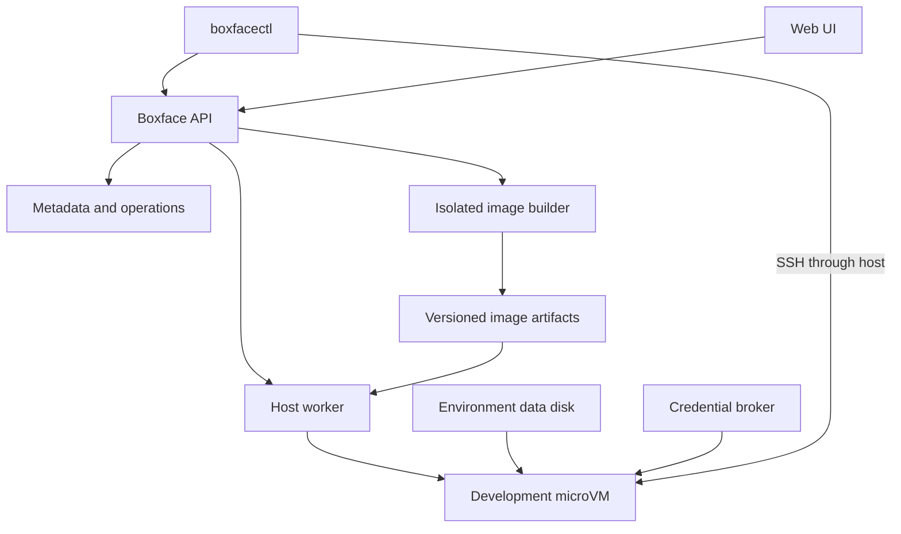

# Boxface architecture

Status: proposed architecture, not an implemented system  
Date: 2026-10-05  
Companions: [MVP](mvp.md) · [Detailed design](design.md)

## 1. Purpose

Boxface provides persistent development environments inside microVMs running on servers the user controls. A lightweight client, including a Linux tablet, can create an environment, connect to it, and use native coding-agent CLIs. The environment remains available when the client disconnects.

The initial user travels with a Xiaomi Pad 6 and owns ThinkCentre machines suitable for hosting development environments. The first goal is dependable daily remote development. Productisation follows evidence from that use and from other users; a managed cloud marketplace is not the initial scope.

Supported workflows include interactive shells, Claude Code, Codex, OpenCode, Pi, ordinary builds, tests, Docker Compose services, and application previews. Agents are applications within an environment. Their exit does not determine the environment's lifetime.

## 2. Requirements and decision status

### Agreed requirements

- The configured OS is the **microVM guest**, not the host OS.
- Do not use NixOS. Build a conventional lightweight Linux guest from configuration.
- Keep **mkosi** for guest image construction and **chezmoi** for personal configuration.
- Install declared developer tools through a build-time user-profile mechanism such as Home Manager. They are not installed as guest system packages.
- mise is an optional declared user tool. It can install runtimes into the connected user's writable state after boot.
- Users cannot modify the managed OS or declared package profile after boot.
- Persistent repositories, user homes, dependencies, and agent state are separate from the managed baseline.
- CLI and web UI use the same recipes, environments, and server API.
- Credentials are supplied at runtime. Support a path to 1Password service accounts without baking secrets into images.
- An environment supports multiple native agent CLIs without a mandatory custom chat interface.

### Proposed implementation choices

| Decision | Initial proposal | Validation needed |
| --- | --- | --- |
| Guest distribution | Minimal Debian | Agent, browser, mise, native dependency compatibility |
| User package compiler | Nix + Home Manager, used in the builder only | Prebuilt closure and profile activation on a non-NixOS guest |
| Hypervisor | Firecracker as first candidate; Cloud Hypervisor as fallback | Rootless Docker, kernel, filesystem and boot behaviour |
| Docker execution | Rootless daemon using system-installed binaries | Representative Compose workloads and filesystem support |
| Metadata | SQLite on one host | Transactional operations and recovery behaviour |
| Persistent disk | One ext4 data image per environment initially | Mount layout, backup and crash recovery |
| Access | SSH through the host on a private network | Tablet connectivity and authentication flow |
| Implementation language | Not selected | Prefer a small native service/CLI stack; choose during implementation |

Do not interpret these proposals as validated integrations. The MVP starts with feasibility gates for the guest image, package profile, and container runtime.

## 3. Three execution locations

| Location | Responsibilities | Explicit exclusions |
| --- | --- | --- |
| Client device | CLI, browser UI, terminal, connection credentials | No local image builder, Nix installation, KVM, or repository copy required |
| Host server | API, worker, builds, images, disks, networking, secret resolution | Guest recipe does not rebuild or reconfigure the host distribution |
| MicroVM guest | Developer shell, agents, builds, tests, project services, user data | No management access to other environments or host Docker socket |

The host must be a supported Linux system with usable hardware virtualisation and KVM. Hardware capacity is not yet known. Do not promise concurrency until CPU, memory, and disk measurements exist.

## 4. Component topology

All server components may run on one ThinkCentre. Logical separation does not imply separate network services or a microservice deployment.

### Boxface API

Authenticates clients, authorises access, validates configuration, stores immutable revisions, creates durable operations, and exposes environment state. It does not execute client-supplied privileged shell commands.

### Host worker

Performs a narrow set of privileged operations: creates disks, launches and stops VMs, configures network devices, and reconciles actual resources with stored intent. It accepts validated identifiers and structured specifications through a local authenticated interface. It owns cleanup and host-restart recovery.

### Image builder

Compiles recipes into mkosi inputs, builds the user package profile, assembles artifacts, and runs image smoke checks. User-supplied build hooks and Nix expressions are executable input. Run them in an isolated build context with no production credentials, resource limits, and no broad host filesystem mounts.

### Artifact store

Stores kernel, root filesystem, optional initrd, user package closure, and manifest under immutable identifiers. For the MVP these may be bundled into one deployable revision while retaining separate logical ownership. Mutable recipe names resolve to revisions before an environment is created.

### Guest integration service

A small Boxface service inside the guest reports readiness, coordinates lifecycle and credentials, and reports session status. Use vsock where supported. Bind its control connection to the specific environment and worker; vsock is transport, not sufficient authorisation by itself. Keep its privileged interface narrow and launch developer commands under the environment owner's guest UID.

### Credential broker

Resolves server-approved secret bindings and delivers only the selected values or capabilities to the correct environment/session. It must not accept arbitrary vault references directly from untrusted guest requests.

## 5. Guest layers

| Layer | Owner/tool | Content | Runtime mutability |
| --- | --- | --- | --- |
| OS | mkosi | Kernel, init, SSH, libraries, system services, Docker binaries/prerequisites | Read-only managed baseline |
| Declared user toolset | Build-time Home Manager/Nix profile | Agents, mise, baseline Node/Rust, utilities | Read-only profile and package store |
| Personal configuration | chezmoi | Shell, Git, editor and agent settings | Seeded/versioned; writable overrides by policy |
| Development state | Guest user | Repositories, mise runtimes, dependencies, sessions, caches | Writable, persistent |
| Runtime state | Guest services | Sockets, temporary files, runtime credential files | Writable, temporary |

Home Manager owns packages; chezmoi owns personal files. Do not allow both to manage the same files. Agent-written authentication and conversation state must not be overwritten by profile application.

The package-profile builder must separate Home Manager's useful package construction from its normal interactive activation workflow. Export the required Nix closure and provide a root-owned profile entry point. Do not expose a writable profile, privileged Nix daemon, or normal `home-manager switch` workflow in the guest. Treat the exact activation mechanism as a feasibility gate.

## 6. Immutability contract

Boxface guarantees that supported developer operations cannot persistently modify the managed baseline. A new baseline requires a configuration revision, build, and explicit deployment.

Enforcement includes a read-only root device, a read-only package store/profile, an unprivileged guest user, no sudo, and no unrestricted rootful Docker socket. Omitting apt or Home Manager executables alone is not enforcement.

This is **not an executable allowlist**. Developers can run downloaded programs, compile software, and install user-scoped dependencies. mise is one supported way to do this. A user can shadow a managed command through their own PATH; the guarantee concerns the baseline bytes and revision, not every executable a user chooses to run.

Rootless Docker is proposed because unrestricted rootful Docker access grants guest-root capabilities. If rootless compatibility is insufficient, reconsider the privilege model explicitly; do not silently weaken the guarantee.

## 7. Persistent state and updates

Use a read-only image plus a persistent environment data disk. Mount writable paths deliberately; avoid a persistent writable overlay over the entire root filesystem, which would conceal baseline changes and preserve system drift.

Keep user home, workspaces, mise downloads, agent history, and rootless Docker data persistent. Keep `/run` and temporary session credentials ephemeral. Any writable service directories require an explicit mount and ownership declaration.

Each environment records its image digest and data-format compatibility metadata. Stopping preserves disk data but ends running processes. Disconnecting preserves processes. Suspend/resume and memory snapshots are outside the initial MVP.

An update builds a new image, stops the environment, creates a consistent data backup, and attaches the data disk to the new revision. Reverting the image does not revert application data. Database and Docker format migrations may limit rollback.

## 8. Networking and access

The host provides outbound guest networking, guest isolation, and a private access path. Deny management-plane and other-guest access by default. Allow required outbound development traffic under a configurable policy.

Use the user's existing private network, such as Tailscale, as a deployment prerequisite rather than implementing a VPN in the MVP. Network reachability does not replace Boxface authentication.

The initial CLI uses the API for control and SSH through the host for the terminal/data path. Validate guest host identity; never disable host-key checking globally. Port forwarding exposes application previews on client loopback by default. Public preview URLs are deferred.

## 9. Agent and session model

The native agent CLI runs in the guest. Boxface does not implement model reasoning, translate agent conversations, or assume a specific provider API.

A session records environment, name, kind, process state, and terminal attachment information. tmux supplies persistent interactive terminals. systemd supervision can support managed background processes. A disconnected terminal can reattach while the guest remains running. After reboot, conversation recovery depends on the agent's own saved state; Boxface must not automatically replay a potentially destructive task.

Agent runtimes must be independent of project runtime overrides. A project's mise-selected Node version must not break the managed agent launcher.

## 10. Trust boundaries

- Trust the host administrator with guest data and credentials; microVMs do not protect guests from a malicious host administrator.
- Treat guest workloads and repositories as untrusted relative to host management services.
- Treat recipes with scripts, Nix expressions, or chezmoi hooks as code requiring server-side authorisation.
- Keep 1Password service-account tokens on the server. Delivered secrets remain readable by the receiving process and often other processes under the same user.
- Separate API tokens, SSH credentials, model credentials, and build credentials.
- Backups of persistent user data can include login state. Memory snapshots, if later introduced, may include secrets too.

## 11. Reliability and observability

Persist intent before performing external actions. Every resource is tagged or named with an environment or operation ID. Reconcile after worker restart; do not infer ownership from a process ID alone.

Expose build logs, operation progress, VM health, resource consumption, and actionable errors. Keep terminal content and model prompts out of central logs by default. Redaction reduces accidental exposure but cannot guarantee removal of arbitrary secrets printed by user programs.

A host crash loses in-memory work. Persistent disks require normal filesystem recovery. Local backups do not protect against host-disk loss; document off-host backup separately.

## 12. Extension points

Preserve narrow interfaces for hypervisor runtime, artifact storage, secret provider, and host placement. Implement one backend first. Future capabilities can include multiple workers, remote object storage, hosted compute, browser terminals, snapshots, and team access controls.

## 13. References

These sources informed the research; the architecture above is a proposed Boxface design, not a claim that the tools implement the entire composition.

- [mkosi](https://github.com/systemd/mkosi)
- [Home Manager standalone setup](https://home-manager.dev/manual/unstable/nix-flakes/standalone.html)
- [chezmoi](https://www.chezmoi.io/what-does-chezmoi-do/)
- [mise configuration](https://mise.jdx.dev/configuration.html)
- [Firecracker](https://github.com/firecracker-microvm/firecracker)
- [Cloud Hypervisor](https://github.com/cloud-hypervisor/cloud-hypervisor)
- [Docker rootless mode](https://docs.docker.com/engine/security/rootless/)
- [Docker privilege implications](https://docs.docker.com/engine/install/linux-postinstall/)
- [1Password service accounts](https://developer.1password.com/docs/service-accounts/)
