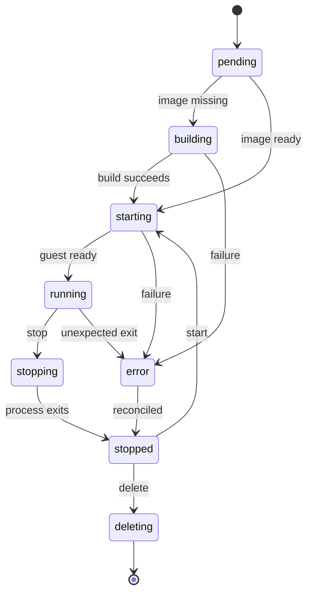

# Boxface detailed design

Status: proposed interfaces and implementation design; examples are not an existing API  
Date: 2026-10-05  
Companions: [Architecture](architecture.md) · [MVP](mvp.md)

## 1. Design contract

Boxface creates a named persistent microVM from a versioned system recipe and a versioned user profile. The server performs building and virtualisation. The CLI needs only network access and authentication; it does not need a local checkout or build tooling.

The guest OS is conventional Linux built with mkosi. Declared developer packages are compiled through Home Manager/Nix before boot. chezmoi configures personal files. Optional mise manages user-scoped runtime installations after boot. An environment remains alive independently of its coding-agent sessions.

The fixed baseline and mutable user state must remain distinguishable in configuration, filesystem layout, lifecycle, and status output.

## 2. Configuration objects

Use a versioned YAML schema. Store submitted source and a canonical validated representation. Reject unknown fields, invalid types, duplicate keys, and incompatible combinations. Never interpret arbitrary YAML tags as executable objects.

The following bundle illustrates the intended interface. Version labels and repository names are illustrative; the resolver must convert them to actual package inputs and immutable source revisions before a build becomes deployable.

```yaml
apiVersion: boxface.dev/v1alpha1
kind: EnvironmentDefinition
metadata:
  name: development
spec:
  system:
    distribution: debian
    release: trixie
    architecture: x86_64
    services:
      ssh: true
      docker:
        mode: rootless
    packages:
      - ca-certificates
      - uidmap
  profile:
    name: personal
    tools:
      - id: claude-code
      - id: codex
      - id: opencode
      - id: pi
      - id: mise
      - id: nodejs
        version: "22"
      - id: rust
      - id: git
      - id: tmux
    dotfiles:
      manager: chezmoi
      source: https://git.example.com/user/dotfiles.git
      revision: main
  runtime:
    cpus: 4
    memoryMiB: 8192
    dataDiskGiB: 80
  credentials:
    - binding: anthropic-development
      scope: session
      consumer: claude-code
      delivery:
        environmentVariable: ANTHROPIC_API_KEY
```

### Interpretation

- `system.packages` contains administrative/system requirements. User-facing agents, language runtimes, and mise belong in `profile.tools`.
- A curated tool catalogue maps stable tool IDs to tested package definitions and launcher metadata. Missing catalogue support is an explicit build error, not an unpinned install script at boot.
- `version` is a requested constraint; resolved inputs record exact versions and sources.
- `dotfiles.revision: main` is resolved once to a commit for the profile revision. A later change to the branch cannot silently alter an existing environment.
- `credentials.binding` references a server-approved binding. A repository cannot grant itself vault access by naming a new reference.
- Runtime sizing does not normally require rebuilding package artifacts. Architecture, kernel requirements, package inputs, and system configuration do.
- Docker cannot be configured as unrestricted rootful access in the initial immutable-baseline mode.

Saved recipes and profiles can also be referenced by ID instead of embedded in a bundle. For the MVP, support the bundle plus saved selections; avoid a general inheritance language. Explicit CLI selections override server defaults. Resource overrides can override saved sizes within host limits. Reject ambiguous duplicate definitions instead of silently merging nested security configuration.

## 3. Resolved build manifest

Record at least:

- Schema version, Boxface builder version, target architecture.
- Canonical recipe and profile revision IDs.
- Distribution package repository snapshot or resolved package versions.
- mkosi version and effective configuration digest.
- Kernel source/version/configuration and required modules.
- Nixpkgs and Home Manager revisions and generated profile expression digest.
- Tool catalogue version, resolved packages, artifact checksums and dependencies.
- chezmoi version, dotfiles commit, and application policy.
- Kernel/rootfs/initrd/profile artifact digests.
- Guest service protocol version and persistent-data compatibility version.
- Build log reference, timestamps, validation results, and provenance.

Hash resolved build inputs for cache lookup; hash final bytes for artifact identity. A recipe hash alone does not prove reproducible output. Avoid using `latest` as a deployable artifact identity. A requested floating version is resolved and recorded.

## 4. Build and assembly

1. Validate authorisation and configuration before fetching private inputs.
2. Resolve pinned sources and compute the build key.
3. Reuse a ready artifact set if the key and compatibility requirements match.
4. Build the user package profile in an isolated builder.
5. Export the profile and complete Nix store closure.
6. Build the Linux filesystem with mkosi, including required system services and guest integration.
7. Assemble the closure at its required `/nix/store` paths and create a platform-controlled executable profile. It may be embedded in the root image for the MVP.
8. Install a controlled personalisation bootstrap and pinned chezmoi source/artifact. Do not include credentials.
9. Produce hypervisor-compatible kernel, root filesystem, and optional initrd.
10. Boot a disposable validation guest, run readiness checks, then atomically publish the artifact set as ready.

Home Manager's standard activation can assume mutable user profiles and Nix tooling. The feasibility spike must identify the minimal generated artifacts and activation steps required. Do not blindly run an arbitrary activation script as root against a persistent user home. Package installation must be complete before developer access is enabled.

Build jobs receive short-lived access only to required private sources. Hooks may execute arbitrary code, so compilation runs separately from host runtime management and credentials. Quotas and cancellation clean up build resources; failed builds never replace a ready revision.

## 5. Guest filesystem and identity

Proposed layout:

| Path | Source | Access |
| --- | --- | --- |
| `/` | Versioned root filesystem | Read-only baseline |
| `/nix/store` | Exported package closure | Read-only baseline |
| `/opt/boxface/profile` | Link to resolved package profile | Root-owned, read-only |
| `/home/dev` | Persistent environment data | Guest user read/write |
| `/workspace` | Persistent environment data | Guest user read/write |
| `/run` | tmpfs | Runtime services, sockets, transient credentials |
| `/tmp` | tmpfs with configured limit | Temporary development files |
| Selected service state paths | Explicit persistent or ephemeral mounts | Service-specific ownership |

One Boxface owner maps to a fixed guest user, initially `dev` with a stable UID/GID. Each environment has its own disk, so the same guest UID across environments is not a shared filesystem identity. Multi-user guests are out of scope.

Rootless Docker storage remains under the developer's persistent data, subject to quota. Verify the chosen storage driver and mount filesystem on the actual guest kernel. Configure the subordinate UID/GID mapping and runtime directory before user access.

Persist guest SSH host identity outside the reusable image. Generate it per environment on first initialisation. Never bake shared host keys, machine IDs, or credentials into a base image. Seed first-boot metadata through a controlled worker-to-guest channel.

The user shell exposes the managed profile as a baseline PATH. mise activation can add project-specific paths above it. Managed agent launchers reference their packaged runtime explicitly.

## 6. Personal configuration lifecycle

Use chezmoi to seed a new home from a pinned profile revision. Record the applied revision and managed file manifest. Reboot is not permission to overwrite the home.

For MVP profile updates:

1. Compare the previous managed content, current file, and new generated content.
2. Automatically update only unchanged managed files.
3. Preserve modified files and report conflicts.
4. Require explicit resolution before overwriting a user's modifications.

An agent's conversation history, mutable login state, and self-managed databases are excluded from the dotfile manifest. Restrict bootstrap hooks to approved build/initialisation actions; no package installation hook should bypass the declared profile build.

Personal preferences may be writable. Security-sensitive platform configuration stays outside the user-owned home and cannot depend on chezmoi enforcement.

## 7. Domain records

| Record | Essential fields |
| --- | --- |
| Owner | ID, authentication records, permitted bindings |
| Recipe revision | ID, source YAML, canonical spec, parent/name, creation time |
| Profile revision | ID, tools, pinned dotfiles, package inputs |
| Image | ID/digest, build key, artifact paths, ready/failed status, compatibility |
| Environment | UUID, owner, name, image ID, resource limits, desired/observed state, disk ID |
| Data disk | ID, path, allocated capacity, retention state, attached environment |
| Session | UUID, environment, name, kind, state, guest session identifier |
| Operation | UUID, type, target, idempotency key, steps, progress, error |
| Credential binding | ID, provider reference, permitted consumer/scope, owner; no plaintext value |
| Backup | ID, source environment/image, checksum, data version, storage location |

Use SQLite transactions for local metadata. Enforce owner/name uniqueness for environments and immutable revision records. Persist process identity with host boot identity and runtime metadata; PID alone is insufficient after restart.

## 8. State machines

Environment desired state is `running`, `stopped`, or `deleted`. Observed state includes `pending`, `building`, `starting`, `running`, `stopping`, `stopped`, `deleting`, and `error`.



An API operation has its own `queued`, `running`, `succeeded`, `failed`, or `cancelled` state. Operation failure must not erase the environment's actual resources. Return structured error codes, retryability, and remediation hints.

A session is `starting`, `running`, `exited`, or `unknown`. Client attachment is a separate property: losing an attachment does not mean the session exited. Host or guest reboot terminates processes; saved transcripts do not imply live session recovery.

## 9. API outline

All routes are proposed and versioned under `/v1`. Require authentication for every operation and authorise ownership per resource.

| Method and route | Purpose |
| --- | --- |
| `GET /health` | Minimal liveness; no sensitive metadata |
| `GET /v1/capabilities` | Runtime, architecture, schema and supported feature information |
| `POST /v1/recipes` | Validate/store recipe revision |
| `POST /v1/profiles` | Validate/store user-profile revision |
| `POST /v1/images/build` | Create asynchronous image-build operation |
| `GET /v1/images` | List ready/failed image revisions |
| `POST /v1/environments` | Create from saved or submitted definition |
| `GET /v1/environments` | List authorised environments |
| `GET /v1/environments/{id}` | Inspect revision, state, resources, operations |
| `POST /v1/environments/{id}/start` | Start retained environment |
| `POST /v1/environments/{id}/stop` | Graceful shutdown |
| `DELETE /v1/environments/{id}` | Remove environment; preserve data unless explicit purge |
| `POST /v1/environments/{id}/connections` | Obtain authorised SSH connection information |
| `POST /v1/environments/{id}/sessions` | Start named user session |
| `GET /v1/environments/{id}/sessions` | List sessions |
| `POST /v1/environments/{id}/backups` | Back up stopped data disk |
| `POST /v1/backups/{id}/restore` | Create independent restored environment |
| `POST /v1/environments/{id}/upgrade` | Explicit revision replacement with backup |
| `GET /v1/operations/{id}` | Inspect durable operation |
| `GET /v1/operations/{id}/events` | Stream resumable operation events |

Long-running mutations return `202 Accepted`, operation ID, and target ID. Support an idempotency key scoped by owner and operation type; reusing a key with different parameters is an error. Serialize conflicting lifecycle mutations per environment.

For the single-owner MVP, use a one-time local bootstrap flow to issue client credentials. Store revocable token hashes server-side; do not ship a default password. Browser access uses an authenticated secure session and CSRF protection. Full OIDC is deferred.

## 10. CLI contract

```bash
boxfacectl server add home https://boxface.example
boxfacectl login
boxfacectl doctor

boxfacectl recipe apply --file recipe.yaml
boxfacectl profile apply --file profile.yaml
boxfacectl create travel --recipe development --profile personal
boxfacectl create experiment --config boxface.yaml
boxfacectl create quick

boxfacectl list
boxfacectl inspect travel
boxfacectl connect travel
boxfacectl connect travel --session coding
boxfacectl exec travel -- git -C /workspace/project status
boxfacectl forward travel 3000:3000

boxfacectl stop travel
boxfacectl start travel
boxfacectl backup travel
boxfacectl upgrade travel --image IMAGE_ID
boxfacectl delete travel
boxfacectl delete experiment --purge-data
```

`create quick` requires configured server defaults. A new environment resolves defaults once and records exact revisions. `connect` to a stopped environment reports its state; an explicit `--start` option can start and wait. Avoid silent image upgrades on connect.

`exec` transports an argument array, working directory, and explicit environment bindings. It does not concatenate untrusted strings into a host shell command. Interactive shell execution is a distinct operation.

The CLI supports structured JSON output and consistent exit codes. It displays server-owned progress and allows reconnection to operation events. Disconnection does not cancel a build or create. Destructive actions require an explicit flag or interactive confirmation; stopping is distinct from deleting data.

## 11. Terminal and preview transport

Use the API to authorise access, then OpenSSH for the data path through the host gateway. Initial implementation can register a user's public key and manage narrowly scoped guest access; credential expiry and revocation must be reflected on subsequent connections. Short-lived SSH certificates are an optional implementation refinement, not required to build the first terminal path.

The gateway resolves environment UUIDs to worker-owned guest endpoints. It must not become an arbitrary tunnel to host management services. Pin host identity and maintain per-environment guest identity across restarts.

tmux provides named reconnectable terminals inside the guest. Do not inject model secrets into a shared tmux server environment. A session launcher requests its approved bindings and constructs the child process environment without command-line secret values or plaintext intermediate files on persistent storage.

`forward travel 3000:3000` binds client loopback by default and forwards to the guest application port through authenticated SSH. Explicitly distinguish guest ports from ports inside Docker containers. Do not automatically expose guest services publicly.

## 12. Credentials and authentication state

Implement a secret-provider interface with resolve, metadata, and failure reporting. The first external adapter uses server-side 1Password CLI/service-account access. Provision its bootstrap token as a protected host credential, outside configuration committed to Git and outside SQLite plaintext records.

A binding maps a server-approved provider reference to an owner, consumer, delivery mode, and scope. Resolve at launch, not image build. A guest cannot choose arbitrary destination environments or expand its own bindings.

Environment delivery is per process where possible. Temporary file delivery uses a runtime directory with restrictive ownership and cleanup. Deleting a file does not remove copies a process already read. Rotation affects new launches unless the consumer supports refresh. Revocation cannot erase a credential already delivered to a running process; stopping/restarting or provider-side revocation may be necessary.

API-key and interactive subscription login paths differ between agents. Validate at least one supported path per agent. Agent-managed OAuth state may need persistent user storage and must be treated as sensitive backup content. Do not promise a universal environment-variable authentication interface.

## 13. Recovery and resource ownership

Each operation is a sequence of idempotent steps with durable completion records. Use temporary paths and atomic publication for images and disks. The worker reconciles managed process metadata, network interfaces, disk attachments, and environment state after restart.

| Failure | Required behaviour |
| --- | --- |
| Image build fails | Mark operation failed; preserve previous ready artifacts; remove owned temporary resources |
| VM launch fails after disk creation | Retain identifiable data disk; remove transient network/process resources |
| API restart | Worker/guest continue; clients resume operations by ID |
| Worker restart | Discover owned VM processes; reconnect or report a recoverable error |
| Host reboot | No sessions claimed live; recover disks and mark environments stopped |
| Guest service unavailable | Distinguish VMM running from guest ready; timeout with diagnostics |
| Disk full | Stop allocation/build safely; retain data; report capacity error |
| Secret lookup fails | Fail only the dependent launch; never fall back to another credential |
| Delete interrupted | Resume cleanup without touching unowned resources |

Image garbage collection protects artifacts referenced by environments, backups, and active operations. Retained data disks remain visible in inventory and consume quota until explicitly purged.

## 14. Backup, restore, and upgrade

The MVP supports consistent **offline** data-disk backups. Stop the guest, flush/close the disk, copy or snapshot the backing storage through a supported mechanism, and record checksums and image compatibility. Local snapshots are not off-host backups.

Restore creates a new disk and environment record. Renew machine/SSH identity for a clone and do not automatically activate restored agent login state without the owner's awareness. A recovery restore intended to replace the same environment must have an explicit identity policy.

Upgrade sequence: resolve new image, verify compatibility, stop, back up, switch image pointer, start, validate. On failure, retain diagnostics and offer image rollback. If the new guest modified persistent formats, require restoring the paired backup for a full rollback; do not claim pointer rollback alone is safe.

## 15. Minimal web UI

Provide server status, recipe/profile revisions, environment creation, environment detail, operation/build progress, start/stop/delete, backup status, and connection instructions. Changes use the same validation and API as CLI requests.

Editing a recipe creates a new revision. Existing environments show that an update is available; they do not change silently. The UI separates stop, delete-with-data-retained, and purge. It never displays resolved credential values.

## 16. Open implementation decisions

1. Confirm ThinkCentre hardware, host distribution, capacity, and private access setup.
2. Select Firecracker or Cloud Hypervisor after the guest/Docker spike.
3. Validate Home Manager artifact extraction/activation on Debian and choose a minimal profile exposure mechanism.
4. Select guest kernel, root filesystem format, and Docker storage driver from measured compatibility.
5. Choose implementation language and HTTP/RPC libraries after component boundaries are accepted.
6. Confirm agent package availability, licensing constraints, release pinning and authentication flows.
7. Decide whether personal file updates need a built-in three-way merge or initially an explicit manual conflict workflow.

## 17. References

- [mkosi image builder](https://github.com/systemd/mkosi)
- [Home Manager standalone setup](https://home-manager.dev/manual/unstable/nix-flakes/standalone.html)
- [chezmoi templating](https://www.chezmoi.io/user-guide/templating/)
- [mise configuration](https://mise.jdx.dev/configuration.html)
- [Docker rootless mode](https://docs.docker.com/engine/security/rootless/)
- [Firecracker snapshot limitations](https://github.com/firecracker-microvm/firecracker/blob/main/docs/snapshotting/snapshot-support.md)
- [1Password runtime secret injection](https://developer.1password.com/docs/cli/secrets-scripts/)
