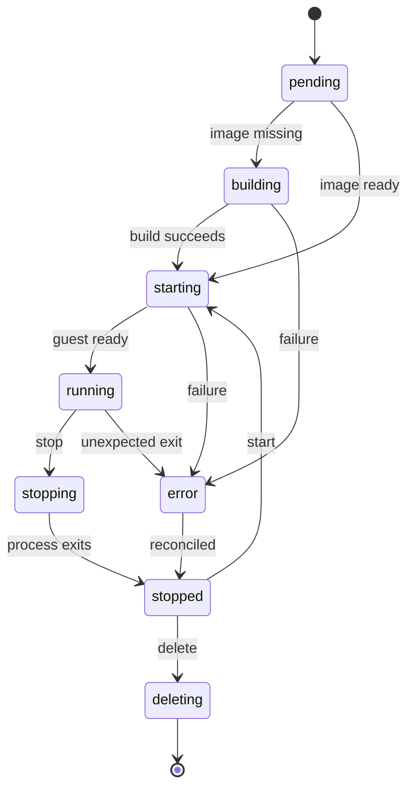

# Host Worker

**Status:** Draft — proposed design; hypervisor not selected

---

## Overview

The host worker performs the narrow set of privileged host operations Boxface needs: it creates disks, launches and stops VMs, configures network devices, and reconciles actual resources with stored intent. It owns cleanup and host-restart recovery.

## Context & Problem

**Background:** The API must never execute client-supplied privileged commands, yet environments need KVM, block devices, and network configuration on the host. Concentrating privilege in one small component with structured inputs keeps the privileged surface auditable.

## Goals

- Accept only validated identifiers and structured specifications
- Keep each environment isolated from other guests and the management plane
- Recover correct ownership after worker or host restart
- Enforce capacity limits instead of relying on host out-of-memory recovery

## Technical Design

### Interfaces & Contracts

- The worker accepts validated identifiers and structured specifications through a local authenticated interface from the API.
- It never runs shell strings supplied by clients; `exec` arguments travel as an argument array (see [boxfacectl](./cli.md)).
- The hypervisor runtime sits behind a narrow interface. Firecracker is the first candidate; Cloud Hypervisor is the fallback. Implement one backend first.

### Environment State Machine

Environment desired state is `running`, `stopped`, or `deleted`. Observed state includes `pending`, `building`, `starting`, `running`, `stopping`, `stopped`, `deleting`, and `error`.

`running` requires the [guest integration service](./guest.md#guest-integration-service) to report readiness; a running VMM alone is not ready. Stopping preserves disk data but ends running processes. A clean stop asks the guest to shut down; with Firecracker this is `SendCtrlAltDel`, which requires the i8042 keyboard driver in the guest kernel ([Gate A](../research/2026-10-gate-a.md)). Disconnecting a client preserves processes. Suspend/resume and memory snapshots are outside the initial MVP.

### Networking

- Provide outbound guest networking, guest isolation, and a private access path.
- Deny management-plane and other-guest access by default. Allow required outbound development traffic under a configurable policy.

### Data Model / State

- Environment: UUID, owner, name, image ID, resource limits, desired/observed state, disk ID.
- Data disk: ID, path, allocated capacity, retention state, attached environment.
- Persist process identity with host boot identity and runtime metadata; PID alone is insufficient after restart.

### Runtime / Operations

- Every resource is tagged or named with an environment or operation ID. Do not infer ownership from a process ID alone.
- After restart, reconcile managed process metadata, network interfaces, disk attachments, and environment state. See [Operations](./operations.md#recovery-and-resource-ownership).
- After a host reboot, no sessions are claimed live; disks recover and previously running environments are reported stopped until explicitly started.

### Capacity

Configure hard memory limits, vCPU limits, maximum environment count, disk quotas, build concurrency, and disk headroom. Reject capacity requests cleanly rather than relying on host out-of-memory recovery. Do not promise concurrency or density until the actual ThinkCentre hardware is measured.

Initial engineering targets are warm start within 15 seconds on a healthy local/private network. These are provisional targets, not guarantees or researched benchmark results.

### Security & Privacy

- The worker is the only component with privileged host access.
- It must not expose the host Docker socket, host home directory, or host Nix daemon to guests.

## Open Questions

- [x] Select Firecracker or Cloud Hypervisor after the guest/Docker spike. Firecracker, provisional until confirmed on the ThinkCentre ([Gate A](../research/2026-10-gate-a.md)).
- [ ] Confirm ThinkCentre hardware, host distribution, and capacity.

## References

- [Architecture](../ARCHITECTURE.md)
- [Operations](./operations.md)
- [Guest](./guest.md)
- [Data Lifecycle](./data-lifecycle.md)
- [Firecracker](https://github.com/firecracker-microvm/firecracker)
- [Firecracker snapshot limitations](https://github.com/firecracker-microvm/firecracker/blob/main/docs/snapshotting/snapshot-support.md)
- [Cloud Hypervisor](https://github.com/cloud-hypervisor/cloud-hypervisor)
