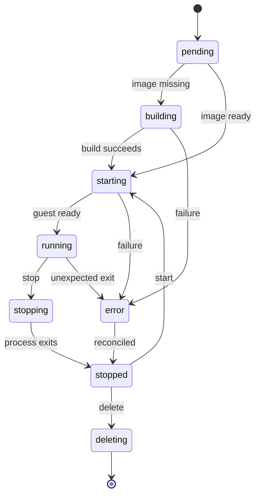

# Host Worker

**Status:** Draft — Firecracker backend; implementation decisions confirmed in the [Durable Server Lifecycle](../plans/2026-10-durable-lifecycle.md#decisions) plan, not yet implemented

---

## Overview

The host worker performs the narrow set of privileged host operations Boxface needs: it creates disks, launches and stops VMs, configures network devices, and reconciles actual resources with stored intent. It owns cleanup and host-restart recovery.

## Context & Problem

**Background:** The API must never execute client-supplied privileged commands, yet environments need KVM, block devices, and network configuration on the host. Concentrating privilege in one small component with structured inputs keeps the privileged surface auditable.

## Goals

- Accept only validated identifiers and structured specifications
- Keep each environment isolated from other guests and the management plane
- Recover correct ownership after worker or host restart
- Enforce capacity limits instead of relying on host out-of-memory recovery

## Technical Design

### Interfaces & Contracts

- The worker runs as root as `boxface-worker` and holds no database. Its systemd unit is `Type=notify`: it reports ready only once its socket is listening, so the API, ordered after it, can reconcile at startup. It accepts validated identifiers and structured specifications from the API as JSON over HTTP on a Unix socket readable only by the `boxface` group, and checks the caller's UID with `SO_PEERCRED`.
- Every call creates or removes one resource idempotently: repeating a call that already took effect changes nothing.
- SSH public keys arrive with each `StartVM`, one validated line each; the worker reads no key file from the host. It writes them to `environments/<id>/authorized_keys.img`, NUL-padded to 4 KiB blocks, and attaches it as a third, read-only drive (`/dev/vdc`). The guest copies it to `/run/boxface/authorized_keys` before `ssh` starts, so the keys follow the owner's current keys at every start and the host never writes into a filesystem the guest controls. The data disk carries no keys.
- The worker generates the guest's ed25519 SSH host key when it creates the disk, seeds it into `/boxface/ssh/` on the disk (which the guest's data setup reuses), and keeps the public half at `disks/<id>.host_key.pub` so clients can pin it before the first connection. Removing the disk removes it.
- `PUT /v1/environments/{id}/credentials` gives the worker an environment's resolved credentials (consumer → variable → value), kept in memory only and cleared when the VM stops; inventory reports `credentials` for environments that have a set. The worker answers guest requests on port 1025 of each VM's own vsock socket, so the socket identifies the environment: a request `{"consumer": "gh"}` gets `{"env": {...}}` with that command's variables only (`session` for session bindings), an empty map for an unbound one, or an error; `{"list": true}` gets the bound command names. Before a set arrives (after a worker restart), a request waits up to 35 seconds for the API's next push, unless it sets `"nowait": true`, as shell start-up does. The worker never calls the API and never logs credential requests or values.
- `GET /v1/environments/{id}/endpoint` returns a running VM's guest address and fails for a stopped one; `GET /v1/disks/{id}/host-key` returns the pinned public host key. The API uses them for the SSH tunnel and dials only port 22.
- It never runs shell strings supplied by clients; `exec` arguments travel as an argument array (see [boxfacectl](./cli.md)).
- The hypervisor runtime sits behind a narrow interface. Firecracker is the first candidate; Cloud Hypervisor is the fallback. Implement one backend first.

### Environment State Machine

Environment desired state is `running`, `stopped`, or `deleted`. Observed state includes `pending`, `building`, `starting`, `running`, `stopping`, `stopped`, `deleting`, and `error`.

`running` requires the [guest integration service](./guest.md#guest-integration-service) to report readiness, received by the worker on the VM's own vsock socket; a running VMM alone is not ready. Stopping preserves disk data but ends running processes. A clean stop asks the guest to shut down; with Firecracker this is `SendCtrlAltDel`, which requires the i8042 keyboard driver in the guest kernel ([Gate A](../research/2026-10-gate-a.md)). Disconnecting a client preserves processes. Suspend/resume and memory snapshots are outside the initial MVP.

### VM Processes

Each Firecracker VM runs in a systemd transient unit named `boxface-vm-<environment-id>.service`, as an unprivileged `boxface-vm` user with access to `/dev/kvm` and the environment's tap device. The unit name identifies the owning environment, VMs keep running when the worker restarts, a host reboot ends them, and cgroup limits enforce memory and CPU; `MemoryMax` is the guest memory plus 256 MiB for Firecracker. The Firecracker jailer is deferred.

The guest's readiness report retries until it is delivered, and the worker listens on each running VM's vsock socket again after a restart, so a report sent while the worker restarts is not lost.

### Networking

- Each environment gets a `/30` from a configured pool (default `172.20.0.0/16`) and its own tap device, `bfx` plus the start of the environment ID. Removing the network releases the address; the next start may allocate a different one. The guest address is passed on the kernel command line (`ip=`) and applied by `systemd-network-generator`, so one image serves every environment.
- nftables allow guest traffic to the internet and drop guest traffic to the host, to other guests, and to private, link-local, and Tailscale ranges (`10.0.0.0/8`, `172.16.0.0/12`, `192.168.0.0/16`, `100.64.0.0/10`, `169.254.0.0/16`, `fd7a:115c:a1e0::/48`), so a guest never reaches the LAN or the tailnet through the host.
- Deny management-plane and other-guest access by default. Allow required outbound development traffic under a configurable policy.

### Data Model / State

- The API is the only writer of intent; records are in [Boxface API](./api.md#data-model).
- The worker discovers actual resources from systemd units, tap devices, and the per-environment directory `/var/lib/boxface/environments/<id>/`, and reports them as inventory. A unit name, not a PID, identifies a VM after restart.

### Runtime / Operations

- Every resource is tagged or named with an environment or operation ID. Do not infer ownership from a process ID alone.
- After restart, reconcile managed process metadata, network interfaces, disk attachments, and environment state. See [Operations](./operations.md#recovery-and-resource-ownership).
- After a host reboot, no sessions are claimed live; disks recover and previously running environments are reported stopped until explicitly started.

### Capacity

Configure hard memory limits, vCPU limits, maximum environment count, disk quotas, build concurrency, and disk headroom. Reject capacity requests cleanly rather than relying on host out-of-memory recovery. Do not promise concurrency or density until the actual ThinkCentre hardware is measured.

Initial engineering targets are warm start within 15 seconds on a healthy local/private network. These are provisional targets, not guarantees or researched benchmark results.

### Security & Privacy

- The worker is the only component with privileged host access.
- It must not expose the host Docker socket, host home directory, or host Nix daemon to guests.

## Open Questions

- [x] Select Firecracker or Cloud Hypervisor after the guest/Docker spike. Firecracker, provisional until confirmed on the ThinkCentre ([Gate A](../research/2026-10-gate-a.md)).
- [ ] Confirm ThinkCentre hardware, host distribution, and capacity.

## References

- [Architecture](../ARCHITECTURE.md)
- [Operations](./operations.md)
- [Guest](./guest.md)
- [Data Lifecycle](./data-lifecycle.md)
- [Firecracker](https://github.com/firecracker-microvm/firecracker)
- [Firecracker snapshot limitations](https://github.com/firecracker-microvm/firecracker/blob/main/docs/snapshotting/snapshot-support.md)
- [Cloud Hypervisor](https://github.com/cloud-hypervisor/cloud-hypervisor)
